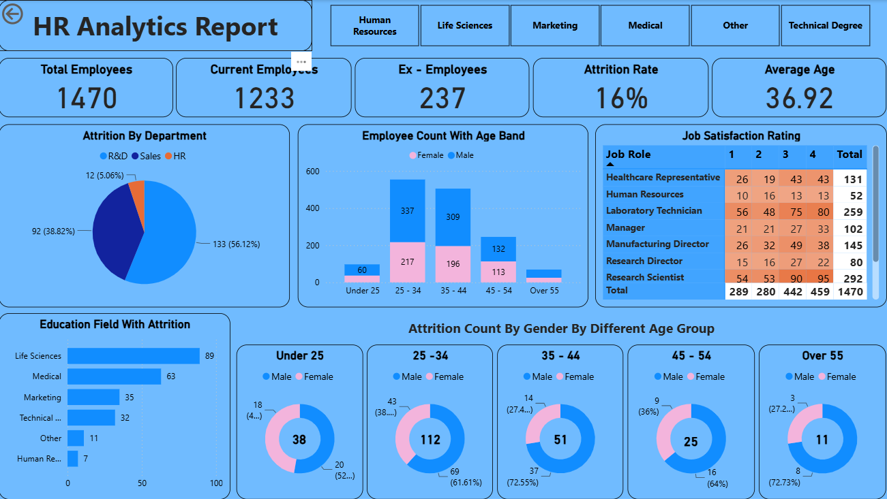

# HR Analytics Dashboard

An independent Power BI practice dashboard about workforce attrition, job satisfaction, and demographic patterns. This is a portfolio practice project, not a client engagement or a measured business-impact study.

## Project files

- [Power BI report](HR%20Analytics%20Dashboard.pbix)
- [Dashboard screenshot](HR-Analytics-Dashboard.png)

## Dashboard scope

The previous README describes views of attrition by department and education field, age and gender, job satisfaction, and workforce demographics. The PBIX is included, but its data model, DAX measures, Power Query steps, and numerical outputs have not been independently checked.

## Data and interpretation

The repository contains no source dataset, data dictionary, analysis code, or dataset citation. The earlier README listed employee counts and subgroup percentages that cannot be verified from the tracked files, so those figures are not repeated here. No causal explanation or business outcome is claimed.

## Open the report

Download the PBIX file and open it in Power BI Desktop. The image below provides a static preview.

## Tools

The project describes Power BI, DAX, and Power Query. The PBIX is the only analytical artifact provided; the report internals have not been validated.
